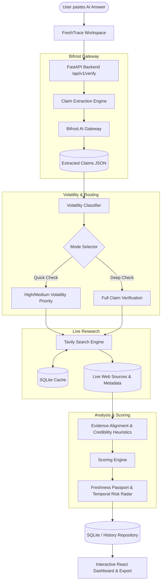

# FreshTrace 🛡️
> **"An answer can be correct yesterday and misleading today."**
>
> Automated Stale-Answer Detection & Claim Freshness Verification Engine for Modern AI Applications.

---

## 📌 Executive Summary & Problem Statement

Large Language Models (LLMs) formulate responses with persuasive confidence. However, **real-world facts are dynamic**:
- **Software releases breaking updates** (e.g. Next.js, Python, Tailwind, React).
- **APIs and pricing models fluctuate** (e.g. token rates, subscription tiers).
- **Company leadership transitions** (e.g. CEOs, founders, appointed roles).
- **Statutes, tariffs, and compliance regulations evolve constantly**.

Because models are bounded by training cutoffs and static context windows, they frequently produce **stale hallucinations**—statements that were once true, but are no longer valid.

**FreshTrace solves this.** It parses AI-generated answers, isolates discrete falsifiable claims, performs live web research using **Tavily**, analyzes evidence consensus, and provides a transparent **Freshness Passport** with **Temporal Risk Radar** assessments.

---

## 🚀 Key Features

### 1. 🛡️ Claim-Level Freshness Passport
Every isolated claim receives an auditable passport detailing:
- Original extracted assertion and claim category
- Freshness Score (0–100) & Verification Status
- Independent Confidence Metric (0–100)
- Temporal Risk Score (0–100)
- Live source citations with direct URLs, publishing timestamps, and domain heuristics
- Suggested recheck interval

### 2. 📡 Temporal Risk Radar
Heuristic assessment of a claim’s vulnerability to knowledge drift:
- **High Volatility (Risk ≥ 70):** Pricing, software versions, leadership, regulatory updates. Recheck recommended every **7 days**.
- **Medium Volatility (Risk 40–69):** Product features, technical specifications, statistics. Recheck recommended every **30 days**.
- **Low Volatility (Risk < 40):** Mathematical definitions, established historical dates, scientific principles. Recheck recommended every **180 days**.

### 3. 🔍 Live Web Research (Powered by Tavily)
- Focused query generation targeting authoritative sources.
- Domain credibility heuristics prioritizing institutional and documentation domains (`.gov`, `.edu`, official documentation, reputable journals).
- Independent domain deduplication (preventing multiple articles on the same domain from distorting consensus).
- SQLite-backed result caching with configurable TTL to respect rate limits.

### 4. ⚡ Resilient AI Gateway (Powered by Bifrost)
- Model-agnostic LLM routing via Bifrost AI Gateway.
- Enforces strict Pydantic JSON schemas for structured claim extraction.
- Automatic retry, timeout handling, and informative provider error states.

### 5. 🔄 Change Detection & Audit Comparison
- Compare two verification runs side-by-side to detect drift over time.
- Highlights status transitions, score deltas, and newly conflicting web evidence.

---

## 🏗️ Architecture & Verification Workflow



---

## 🛠️ Technology Stack

- **Backend:** Python 3.10, FastAPI, Pydantic v2, SQLAlchemy 2.0, HTTPX, SQLite, python-dotenv
- **AI Gateway:** Bifrost AI Gateway (configurable for OpenAI, Anthropic, Google)
- **Live Search:** Tavily Search API
- **Frontend:** React 18, TypeScript, Vite, Tailwind CSS v4, Lucide Icons
- **Testing:** Pytest, pytest-asyncio, pytest-mock
- **DevOps:** Docker, Docker Compose

---

## 📋 Directory Structure

```
FreshTrace/
├── backend/
│   ├── app/
│   │   ├── api/routes/          # health.py, verify.py, history.py
│   │   ├── core/                # logging.py, exceptions.py
│   │   ├── database/            # base.py, models.py, session.py, repositories/
│   │   ├── schemas/             # claim.py, source.py, verification.py
│   │   ├── services/            # bifrost_service.py, tavily_service.py,
│   │   │                        # claim_extraction_service.py, evidence_service.py,
│   │   │                        # volatility_service.py, scoring_service.py,
│   │   │                        # verification_service.py
│   │   ├── tests/               # pytest test suite
│   │   ├── config.py            # Environment configuration
│   │   └── main.py              # FastAPI app definition
│   ├── main.py                  # CLI / uvicorn entrypoint
│   ├── requirements.txt         # Pinned backend dependencies
│   ├── .env.example             # Environment template
│   └── Dockerfile               # Backend container definition
├── frontend/
│   ├── src/
│   │   ├── components/          # Navbar, LandingHero, Workspace, ResultsDashboard, HistoryView, AboutModal
│   │   ├── services/            # api.ts (backend client)
│   │   ├── types/               # TypeScript interfaces
│   │   ├── App.tsx              # Main application shell
│   │   └── main.tsx             # Vite React entrypoint
│   ├── package.json
│   ├── tsconfig.json
│   ├── tailwind.config.js
│   └── Dockerfile
├── docker-compose.yml           # Multi-container orchestration
├── .gitignore                   # Excludes secrets, venv, node_modules, DB
└── README.md
```

---

## ⚙️ Setup and Installation (Windows & Cross-Platform)

### Prerequisites
- **Python 3.10+**
- **Node.js 18+ & npm**
- **Git**

---

### Step 1: Clone and Configure Environment

```powershell
# Navigate into the project folder
cd D:\FreshTrace

# Copy environment template
cp backend/.env.example backend/.env
```

Open `backend/.env` and supply your API keys:
```env
BIFROST_BASE_URL=http://localhost:8080/v1
BIFROST_API_KEY=your_bifrost_api_key_here
AI_PROVIDER=openai
AI_MODEL=gpt-4o-mini
TAVILY_API_KEY=tvly-your_tavily_api_key_here
```

> **Note on Missing Credentials:** If keys are omitted or set to placeholders, the backend safely informs the client via HTTP 503 with exact instructions on which credential to configure.

---

### Step 2: Run the Backend

```powershell
cd D:\FreshTrace\backend

# Activate virtual environment
.\.venv\Scripts\activate

# Install dependencies (if needed)
pip install -r requirements.txt

# Start FastAPI server
uvicorn main:app --host 127.0.0.1 --port 8000 --reload
```
The backend will be live at: `http://127.0.0.1:8000`
- Interactive OpenAPI Docs: `http://127.0.0.1:8000/docs`
- Health check: `http://127.0.0.1:8000/health`

---

### Step 3: Run the Frontend

In a separate terminal:
```powershell
cd D:\FreshTrace\frontend

# Install dependencies
npm install

# Start Vite development server
npm run dev
```
Open your browser at: `http://localhost:5173`

---

### Step 4: Run with Docker Compose (Optional)

```powershell
docker-compose up --build
```
- Frontend: `http://localhost:5173`
- Backend API: `http://localhost:8000`

---

## 🧪 Testing

Run backend tests:
```powershell
cd D:\FreshTrace\backend
.\.venv\Scripts\pytest.exe app/tests/test_volatility.py app/tests/test_scoring.py app/tests/test_evidence_service.py
```

Run frontend production build verification:
```powershell
cd D:\FreshTrace\frontend
npm run build
```

---

## 📊 Transparent Scoring Methodology

1. **Freshness Score (0–100):**
   - **Base:** 50 (neutral).
   - **Support:** +15 to +35 based on supporting evidence weighted by domain authority.
   - **Contradiction:** -25 to -50 when evidence reveals updated versions, discontinued services, or superseded prices.
   - **Recency:** +15 bonus when recent timestamps (past 1–2 years) corroborate high-volatility claims.
   - **Consensus:** +10 bonus when 2+ independent domains agree without contradiction.

2. **Confidence Score (0–100):**
   - Computed independently from freshness. Measures volume of sources retrieved, domain variety, and internal evidence consistency.

3. **Temporal Risk Score (0–100):**
   - Evaluates rate-of-decay based on claim domain (pricing/versions = high; math/physics = low) combined with evidence age.

---

## ⚖️ Limitations & Disclosures

- **Heuristic Assessment:** Credibility ratings and freshness scores represent algorithmic heuristics and model synthesis, not legal or scientific verification.
- **Search Engine Coverage:** Tavily accesses indexed public web pages; paywalled or non-indexed internal databases cannot be examined.
- **AI Gateway Dependency:** Bifrost gateway availability determines claim extraction speed and fidelity.

---

## 🏆 Hackathon Challenge Information

Built for the **"Build a Stale-Answer Detector for AI Applications"** challenge.
- **Bifrost by Maxim AI** integration: AI model gateway for structured extraction.
- **Tavily Search API** integration: Live web grounding and evidence gathering.
